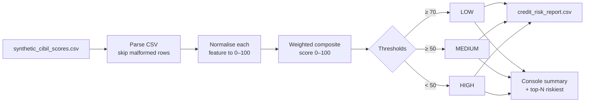

# Credit Risk Analyzer


A Java command-line tool with no dependencies. It scores loan applicants on a 0–100 **composite credit score** and sorts them into **LOW / MEDIUM / HIGH** risk. Weights and thresholds are configurable, it writes a CSV report, and it prints the highest-risk applicants.

---

## Problem Statement

Lenders have to rank applicants by risk from several credit signals at once: bureau score, repayment behaviour, utilisation and indebtedness. This tool combines those signals into one transparent, weighted, tunable score and a risk band, so the decision logic is easy to explain and adjust.

## Dataset

`synthetic_cibil_scores.csv` holds **10,000 synthetic applicants** with seven columns:

| Column | Meaning | Direction |
|---|---|---|
| `Payment_History` | 0–100 | Higher is better |
| `Credit_Utilization` | Ratio | Lower is better |
| `Credit_Age` | Years | Higher is better |
| `Number_of_Accounts` | Count | Read, not weighted |
| `Hard_Inquiries` | Count | Lower is better |
| `Debt_to_Income_Ratio` | Ratio | Lower is better |
| `CIBIL_Score` | 300–900 | Higher is better |

## Approach

Each feature is normalised to 0–100, then combined as a weighted sum:

| Component | Normalisation | Default weight |
|---|---|---|
| CIBIL score | (score − 300) / 600 × 100 | 0.40 |
| Payment history | clamp 0–100 | 0.20 |
| Credit utilisation | (1 − min(CU, 2) / 2) × 100 | 0.15 |
| Credit age | min(age, 30) / 30 × 100 | 0.10 |
| Debt-to-income | (1 − min(DTI, 2) / 2) × 100 | 0.08 |
| Hard inquiries | (1 − min(HI, 10) / 10) × 100 | 0.07 |

**Risk mapping (defaults):** composite ≥ 70 → **LOW**, ≥ 50 → **MEDIUM**, otherwise **HIGH**.

Custom weights are normalised automatically so they sum to 1. Custom thresholds are checked so that the medium threshold stays below the low threshold.

## Workflow



## Tech Stack

- **Java** (standard library only: `java.nio.file`, Streams, `DecimalFormat`)
- **Bash** helper script

## Project Structure

```
Credit-Risk-Analyzer/
├── CreditRiskAnalyzer.java     # Source: CSV parsing, scoring, risk mapping, report
├── synthetic_cibil_scores.csv  # Input dataset (10,000 applicants)
├── credit_risk_report.csv      # Generated report (default settings)
├── run.sh                      # Compile + run with default arguments
├── .gitignore
└── README.md
```

## How to Run

**Prerequisite:** JDK 8 or later.

```bash
git clone https://github.com/Gonugunta-Venkata-Jayanth/Credit-Risk-Analyzer.git
cd Credit-Risk-Analyzer

# Quick start
bash run.sh

# Or manually
javac CreditRiskAnalyzer.java
java CreditRiskAnalyzer --input synthetic_cibil_scores.csv --output credit_risk_report.csv --top 20 \
     --weights 0.4,0.25,0.12,0.1,0.08,0.05 --thresholds 52,72
```

### CLI Options

| Flag | Description | Default |
|---|---|---|
| `--input <file>` | Input CSV | `synthetic_cibil_scores.csv` |
| `--output <file>` | Output CSV | `credit_risk_report.csv` |
| `--top <N>` | Print the N highest-risk applicants | `10` |
| `--weights w1,...,w6` | Order: CIBIL, Payment, CreditUtil, CreditAge, DTI, HardInq (normalised) | `0.40,0.20,0.15,0.10,0.08,0.07` |
| `--thresholds med,low` | Composite cut-offs for MEDIUM and LOW risk | `50,70` |
| `-h`, `--help` | Show usage | |

### Output

`credit_risk_report.csv` contains `ID, Payment_History, Credit_Utilization, Credit_Age, Number_of_Accounts, Hard_Inquiries, Debt_to_Income_Ratio, CIBIL_Score, Composite_Score, Risk_Level`.

## Results

These are the figures in the committed `credit_risk_report.csv`, generated with the default weights and thresholds:

| Risk level | Applicants |
|---|---|
| LOW | 1,662 |
| MEDIUM | 4,767 |
| HIGH | 3,571 |
| **Total** | **10,000** |

Average composite score: **55.75**.

## Limitations

- The CSV reader splits naively on commas. Pre-process the data, or improve the parser, if fields contain commas.
- Tune the weights and thresholds for your own use case. The defaults are heuristic, not fitted to default outcomes.

## Author

**Jayanth Gonugunta Venkata** · [GitHub](https://github.com/Gonugunta-Venkata-Jayanth)
